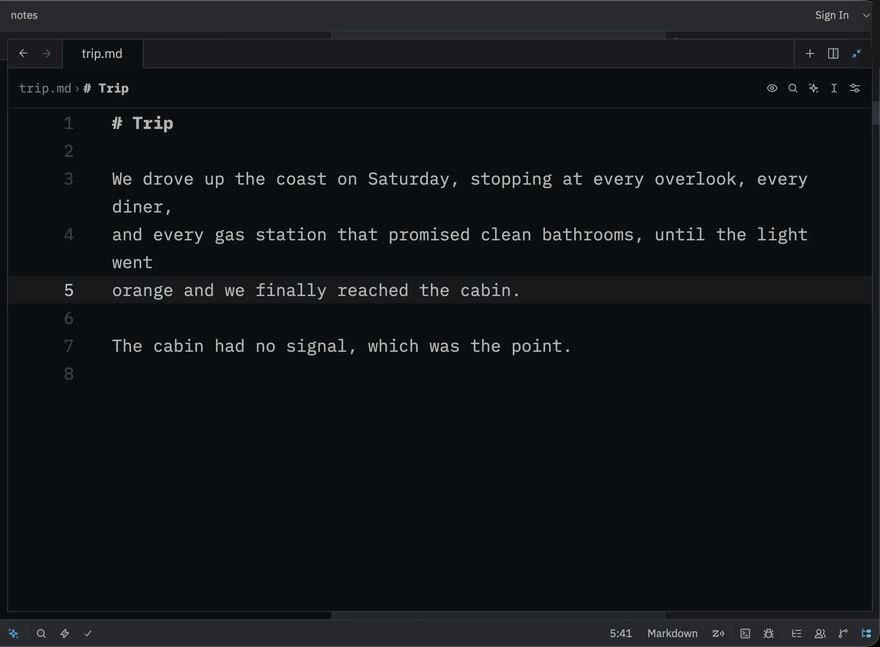

    ^ what is this?
    ^> This is the README for Ambition, a tool that lets you talk to an AI
    ^> through files in your editor. Write a line starting with `^` and save;
    ^> the AI edits the file or answers there. It uses T3 Code to run the AI
    ^> and keeps a private git history so you can undo its changes.

  

Ambition turns a folder into something you can talk to. There is no chat
box. In any file there, start a line with `^`, write what you want, and
save. The answer lands in the file, or the file itself changes.

## Three marks

    ^ make this shorter     a prompt: your save sends it to the agent
    ^/undo                  a command: answered at once, in code, with no model
    ^> the answer is 4      a reply: your next save clears it

That is all the syntax there is.

## Get it

One file, and one line of config.

    curl -fsSL https://github.com/MannyFluss/ambition/releases/latest/download/ambition-$(uname -m)-$(uname -s).tar.gz | tar xz
    ./ambition ~/notes

The first run writes `~/notes` to `~/.config/ambition`, so from then on
`ambition` alone is enough. Put the file anywhere on your PATH. With Rust:
`cargo install --git https://github.com/MannyFluss/ambition`.

It needs two things beside it:

- **git**, for the private history that makes undo work.
- **[T3 Code](https://github.com/pingdotgg/t3code)**, open. Each folder's
  agent is one T3 thread, with everything a T3 thread can do (a shell, the
  web, other agents), and you can open the thread to read exactly what each
  save sent.

It is tested on macOS. The same release builds it for Linux and Windows,
but those have not been tried yet.

## Why it works this way

**Your attention is the scarce thing.** The caret marks where you are
looking, and that is all the context you give. Ambition sends the agent
your words, the text just above and below the caret, and what you changed
since its last turn.

**The document is the interface.** There is no window to switch to. The
answer lands where you were looking: as an edit, or as `^>` lines under
your prompt.

**Quiet.** Nothing runs until you save, and a save with no caret does
nothing. Between saves Ambition sleeps until the operating system says a
file changed: watching a folder for eight minutes, through a setup and one
answered prompt, it used 0.05 seconds of processor time and under 5 MB of
memory. `^/` commands answer in code, with no model.

**Nothing is final.** Ambition keeps a private git history of the folder,
apart from your own repo, and `^/undo` takes back the agent's last turn. So
the agent acts instead of asking for permission.

**Show, don't claim.** What the agent is told is one file you can read,
[RULES.md](RULES.md), exactly as every thread receives it. How it reads the
caret was settled by an experiment you can rerun
([below](#how-it-reads-the-caret)). And the thread shows every message it
was sent.

## Ten saves

[TUTORIAL.md](TUTORIAL.md) is a file you play in: a command, a first
prompt, undo, a table filled from above it, one long memory, the models,
your own command, a script it writes and runs. Drop it into your folder:

    curl -fsSLo ~/notes/tutorial.md https://raw.githubusercontent.com/MannyFluss/ambition/main/TUTORIAL.md

## Commands

    ^/help                  the commands, with what each does
    ^/model                 the models T3 offers, the one in use marked
    ^/model opus high       switch the thread's model (and effort), by T3's own search
    ^/new                   the next prompt starts a new thread, with a handoff
    ^/thread                the link to this folder's thread in T3
    ^/stop                  stop the turn that is running
    ^/undo                  take back Ambition's last change

Your own commands are scripts in `.ambition/commands/`, one file each:
`count.sh` answers `^/count`. The paragraph above the command arrives on
stdin, and what the script prints becomes the reply. Ask for one in plain
words, and the agent writes it there.

## In your editor

Ambition only watches files, so any editor works. For colors, completion,
and a hover that shows what a prompt will send, it also has a language
server: `ambition lsp`.

- **Zed**: `editors/zed/install.sh` adds the extension. Then turn on the two
  features it uses, which Zed keeps off by default, in the folder's
  `.zed/settings.json`:

      { "semantic_tokens": "combined", "inlay_hints": { "enabled": true } }

- **Neovim** (0.11 or later):

      vim.lsp.config('ambition', { cmd = { 'ambition', 'lsp' }, root_markers = { '.ambition' },
        filetypes = { 'markdown', 'text', 'python', 'javascript', 'rust' } })
      vim.lsp.enable('ambition')

- Any other editor that speaks LSP: start `ambition lsp`. Only Zed and
  Neovim have been tried.

## How it reads the caret

The agent is told the file and line of each prompt, the paragraphs just
above and below its caret, and the file around it. That was chosen by
[examples/context.rs](examples/context.rs), which ran 16 prompts whose right
answers are known (a table under the caret, a section under a heading, a
sentence between two paragraphs, a question inside a function, an entry 140
lines from the one to copy) through real T3 threads, four ways, twice each:

|                         | Claude Sonnet 5.5 | Claude Haiku 5.5 | a turn, Haiku |
|-------------------------|-------------------|------------------|---------------|
| the paragraph above     | 32 of 32          | 31 of 32         | 9.7 s         |
| **above and below**     | 32 of 32          | 32 of 32         | 10.8 s        |
| file and line only      | 32 of 32          | 32 of 32         | 17.7 s        |
| the whole file          | 32 of 32          | 32 of 32         | 10.3 s        |

The paragraph above, which is how it first worked, missed the one prompt
that asks for a sentence between two paragraphs: it added the sentence to a
paragraph instead. File and line alone is slowest, because the agent reads
the file first. The whole file does as well, but it sends all of a file
every time; above and below stays small as files grow.

## Inside

- Everything Ambition keeps for a folder is in its `.ambition/`: your
  commands, `history.md` (every prompt and reply), the agent's `notes.md`,
  and the private history. A `.gitignore` inside keeps it out of your own
  repo. Delete it, and Ambition forgets the folder.
- One thread per folder, across files and days. A new one starts on
  `^/new`, when the rules change, or when the folder's own `AGENTS.md`
  changes, with a handoff from the one before.
- The engine is T3 Code, behind one small trait
  ([src/engine.rs](src/engine.rs)). Another engine is one more `impl`.
- `cargo test` runs the real binary against a fake T3, save by save.

## Where it could go

The caret could live in every text field on a computer, not only in a
folder's files. That needs a permission over the whole machine, so it is
not here. It is yours to try.

---

MIT. Made by [MannyFluss](https://github.com/MannyFluss).
